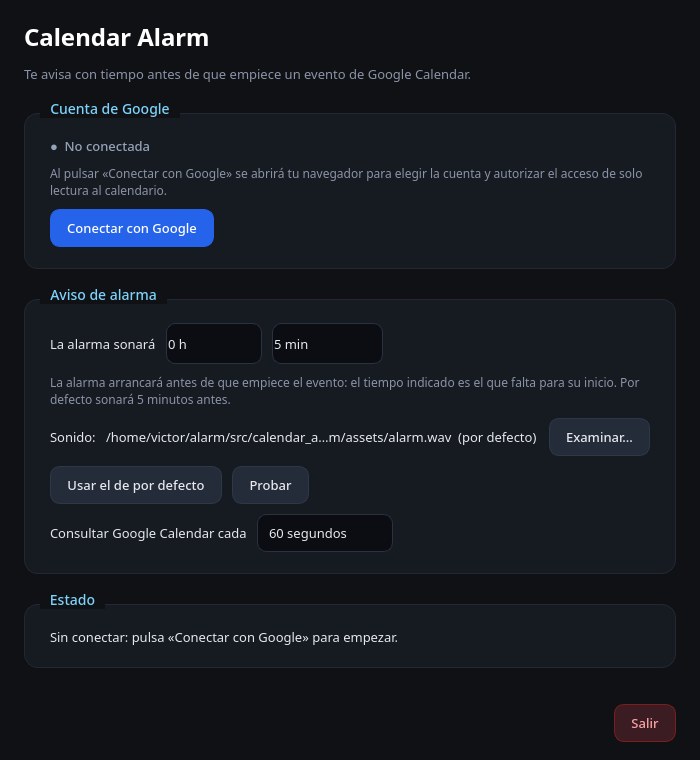
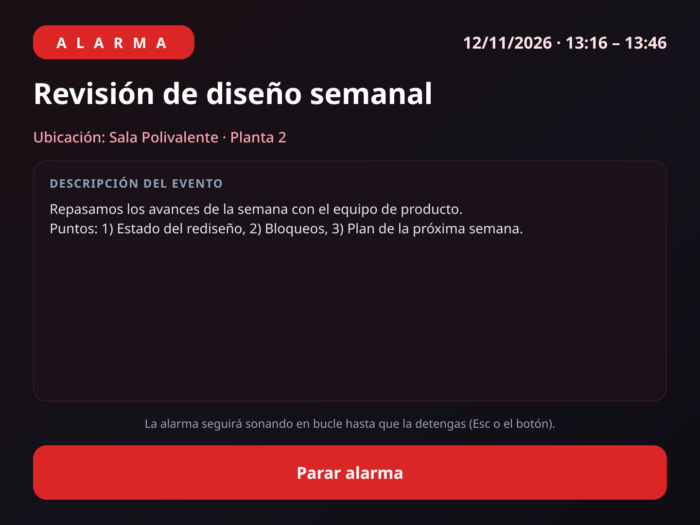

# Calendar Alarm — Alarmas de Google Calendar

Aplicación de escritorio multiplataforma (**Windows, Linux y macOS**) escrita en
Python y gestionada con [uv](https://docs.astral.sh/uv/). Suena una alarma
personalizable **antes** de que empiece un evento de Google Calendar.

| Configuración | Aviso de alarma |
|---|---|
|  |  |

## Características

- **Margen de aviso configurable** por el usuario en horas y minutos
  (por defecto **5 minutos** antes del evento).
- **Hilo de fondo** que consulta la API de Google Calendar periódicamente
  (`google-api-python-client`) sin bloquear la interfaz.
- **Aviso visual prominente** con toda la información del evento: título,
  descripción, ubicación y horario.
- **Sonido en bucle continuo** con `pygame` (sin bloquear la UI), con un
  sonido por defecto incluido y opción de elegir un archivo personalizado
  (`.wav`, `.mp3`, `.ogg`, `.flac`).
- **Icono en la bandeja del sistema** con menú contextual dinámico:
  - Alarma sonando → **Mostrar**, **Parar alarma**, **Salir**.
  - Sin alarma → **Salir**.
  - Clic izquierdo en el icono → abre la ventana (o la alarma si está sonando).
- **Autenticación con Google desde la propia interfaz**: botón para conectar,
  cerrar sesión y cambiar de cuenta.
- Al elegir **Salir** se detiene el audio, se finaliza el hilo de fondo y la
  aplicación termina por completo. Lo mismo ocurre con las salidas que pide el
  sistema (⌘Q o **Salir** del Dock en macOS, cierre de sesión); cerrar una
  ventana con la ✕ solo la oculta en la bandeja.

## Requisitos

- Python 3.11–3.13 (uv lo descarga automáticamente si no lo tienes).
- `uv` (https://docs.astral.sh/uv/).

## Instalación

```bash
uv sync
```

`uv sync` crea el entorno virtual, instala la aplicación en modo editable y las
dependencias de desarrollo del grupo `dev` (ruff, pytest, pytest-qt,
pytest-cov y mutmut).

Calidad de código:

```bash
uv run ruff check src tests scripts packaging
uv run ruff format src tests scripts packaging
```

## Tests

```bash
uv run pytest                 # toda la suite (~10 s)
uv run pytest --cov           # con informe de cobertura
uv run mutmut run             # tests de mutación (Linux/macOS, ~20 s)
uv run mutmut results         # mutantes que sobreviven
```

No necesitan red, cuenta de Google, pantalla ni tarjeta de sonido: Qt corre en
modo `offscreen`, pygame con el driver de audio `dummy`, y cada test usa una
carpeta de configuración temporal (nunca toca tu `config.json` ni tu
`token.json`).

| Tipo | Dónde | Qué comprueba |
|---|---|---|
| **Unitarios** | `tests/unit/` | Lógica sin interfaz: cuándo suena la alarma (límites exactos del margen y de la tolerancia), configuración, parseo de eventos de Google, credenciales OAuth, sesión y renovación del token, flujo de autorización (incluida la cancelación y el tiempo límite) y audio. |
| **Interfaz** | `tests/ui/` | Ventana principal (botón **Cancelar**, ajustes, sonido), ventana de alarma, bandeja, icono e integración con Hyprland, con Qt sin pantalla. |
| **Integración** | `tests/ui/test_app.py` | La app completa: alarma de principio a fin, parada desde la bandeja y salidas (**Salir**, ⌘Q/Dock, guardado de la configuración), cada salida en su propio proceso (`tests/ui/quit_scenarios.py`). |
| **Empaquetado** | `tests/packaging/` | `build.py` para Windows, Linux y macOS (opciones de PyInstaller, búsqueda de Python y del lanzador `py`, uv/pip, credenciales, reintentos de `hdiutil`), iconos ICO/ICNS y el punto de entrada sin consola. |
| **Mutación** | `mutmut` | Introduce cambios pequeños en la lógica (`<=` por `<`, `True` por `False`, otro texto…) y comprueba que algún test falla. Resultado actual: 558 de 582 mutantes detectados (96 %). |
| **Humo** | `scripts/smoke_test.py` | Arranque real, alarma y salida, como script independiente. |

Los 24 mutantes que sobreviven no cambian el comportamiento observable en
macOS/Linux: codificación `"utf-8"` frente a `"UTF-8"` o la predeterminada
(UTF-8 en estos sistemas; en Windows los detecta el test con «música» y «ñ»),
`unlink(missing_ok=False)` dentro de un `except OSError`, relleno base64 que el
decodificador tolera, `>` frente a `>=` en el tiempo límite, la ruta alternativa
de `asset_path` (idéntica en desarrollo) y valores iniciales `None` frente a
`""` que nunca se leen.

El workflow `.github/workflows/tests.yml` ejecuta ruff, la suite y la prueba de
humo en **Linux, Windows y macOS** en cada push y pull request; los tests de
mutación se lanzan a mano (**Actions → Tests → Run workflow** marcando
«mutation»).

## Ejecutable nativo (Windows / Linux / macOS)

La aplicación se puede distribuir como **ejecutable autocontenido** (incluye
Python, todas las dependencias y los recursos) para el sistema en el que se
compila:

```bash
python3 packaging/build.py
```

> Si tienes **uv** instalado, el script lo usa para crear el entorno de build
> (rápido y con caché: PySide6 solo se descarga la primera vez). Si no, usa un
> Python 3.11–3.13 del sistema con `venv` + `pip` (en Windows también lo busca
> con el lanzador `py`). Si tu `python3` es otra versión, ejecuta
> `python3.13 packaging/build.py`.

| Sistema  | Resultado                                              |
|----------|--------------------------------------------------------|
| Windows  | `dist/CalendarAlarm.exe`                               |
| Linux    | `dist/calendar-alarm`                                  |
| macOS    | `dist/Calendar Alarm.app` + `dist/CalendarAlarm.dmg`   |

El script crea un entorno de empaquetado **aislado** en `build/build-env/` con
PyInstaller, así que **no altera el `.venv` de desarrollo**. Los iconos se
generan automáticamente (`packaging/make_icons.py`).

Instrucciones completas (dependencias por sistema, cómo arrancar el ejecutable,
firma/cuarentena, límites de `glibc`/arquitectura y compilación de los tres
sistemas con GitHub Actions): **[BUILD.md](BUILD.md)**.

## Conectar con Google (sin archivos que subir)

La aplicación **incluye su propio cliente OAuth de Google**, así que el usuario
final solo tiene que pulsar **Conectar con Google**: se abre el navegador, elige
su cuenta, autoriza el acceso de solo lectura y listo. No hay que descargar ni
seleccionar ningún `client_secret.json`.

> Google exige que toda aplicación registre un cliente OAuth. Ese registro se
> hace **una vez** (lo hace quien compila/distribuye la app) y sus credenciales
> se empaquetan dentro del ejecutable. Google considera que el secreto de un
> cliente de *Aplicación de escritorio* no es confidencial.

### Registrarlo una sola vez (para quien compila)

1. Entra en [Google Cloud Console](https://console.cloud.google.com/).
2. Crea un proyecto (p. ej. `calendar-alarm`).
3. **APIs y servicios → Biblioteca → Google Calendar API → Activar**.
4. **Pantalla de consentimiento OAuth → Crear → Externo**: nombre de la app,
   email de soporte y tu cuenta como **usuario de prueba** (hasta 100 mientras
   la app no esté verificada).
5. **Credenciales → Crear credenciales → ID de cliente de OAuth**, tipo
   **Aplicación de escritorio**. Descarga el JSON.

**Guárdalo como `client_secret.json` en la raíz del proyecto.** Ese nombre ya
está en `.gitignore`: no se sube a GitHub. Al compilar, el script lo lee y lo
inyecta **solo en el binario**:

```bash
python3 packaging/build.py
```

El código fuente y git quedan limpios: las credenciales acaban únicamente en
`build/build-env/` (y por tanto dentro del ejecutable). También puedes usar
otra ubicación con `CALENDAR_ALARM_GOOGLE_CLIENT_FILE=/ruta/al/json`, o pasar
`CALENDAR_ALARM_GOOGLE_CLIENT_ID` y `CALENDAR_ALARM_GOOGLE_CLIENT_SECRET` como
variables de entorno (lo que usa el CI con secrets).

Para desarrollo, sin compilar:

```bash
CALENDAR_ALARM_GOOGLE_CLIENT_FILE=client_secret.json uv run calendar-alarm
```

Si no hay credenciales por ninguna vía, el botón muestra un aviso y el build
avisa de que el ejecutable no podrá conectarse.

> **No** uses credenciales de tipo «Aplicación web»: su secreto sí es
> confidencial y no debe distribuirse. El `token.json` de cada usuario se
> guarda solo en su equipo (en Linux y macOS, con permisos `600`).

## Uso

```bash
uv run calendar-alarm
```

1. Pulsa **Conectar con Google** (se abre el navegador) y autoriza el acceso
   de solo lectura a tu calendario. Mientras espera aparece un botón
   **Cancelar**: úsalo si Google muestra un error o cierras la pestaña, para
   volver a intentarlo sin esperar.
2. Define el margen de aviso en **horas** y **minutos** (por defecto 0 h 5 min):
   es el tiempo **antes** del inicio del evento en el que arrancará la alarma.
3. Elige tu sonido (o deja el incluido) y pulsa **Probar** si quieres.
4. La aplicación consulta Google Calendar cada 60 s (configurable). Cuando un
   evento esté a menos del margen, sonará la alarma, se mostrará la ventana
   aviso con los datos del evento y la ventana principal se minimizará a la
   bandeja. Cada evento avisa una sola vez; si lo mueves a otra hora, vuelve
   a avisar con el nuevo horario.

### Comportamiento de la bandeja

| Estado            | Menú contextual                  |
|-------------------|----------------------------------|
| Alarma sonando    | **Mostrar**, **Parar alarma**, **Salir** |
| Sin alarma        | **Salir**                        |

- **Mostrar** (solo visible con la alarma activa) abre la ventana de alarma con
  la descripción y los datos relevantes del evento.
- Si la aplicación está en primer plano al sonar, esa misma ventana de alarma
  aparece automáticamente encima de todo.
- Clic izquierdo en el icono: abre la ventana principal (o la de alarma si
  suena).

## Gestores de ventanas de mosaico (Hyprland, i3, sway…)

En un **tiling WM** las ventanas nuevas se colocan en mosaico y el tamaño
solicitado se ignora. La aplicación ya lo tiene en cuenta:

- La **ventana principal** lleva todo su contenido dentro de un área
  desplazable con un mínimo pequeño, así que en un tile estrecho aparecen
  barras de desplazamiento en lugar de recortarse la interfaz.
- La **ventana de alarma** se convierte automáticamente en flotante, se
  centra y se fija (visible en todos los escritorios) cuando se detecta
  Hyprland (`HYPRLAND_INSTANCE_SIGNATURE` + `hyprctl`). Se soportan tanto la
  API Lua de Hyprland ≥ 0.56 (`hl.dsp.window.float/center/pin`) como los
  `dispatch` clásicos de versiones anteriores.

Si prefieres controlarlo desde tu configuración de Hyprland, añade estas
reglas (el comportamiento automático es idempotente y no molesta). Se basan en
el título para funcionar tanto en desarrollo como en el ejecutable:

```ini
windowrulev2 = float,  title:^(Calendar Alarm — AVISO)$
windowrulev2 = center, title:^(Calendar Alarm — AVISO)$
windowrulev2 = pin,    title:^(Calendar Alarm — AVISO)$
```

La clase (`app_id`) de la aplicación es `calendar-alarm` en Linux; en Windows y
macOS es `CalendarAlarm`. También puedes usarla si lo prefieres:
`windowrulev2 = float, class:^(calendar-alarm)$`.

En i3/sway no se hace ninguna integración automática: usa la regla
`for_window [title="Calendar Alarm — AVISO"] floating enable` /
`for_window [...] move position center`.

## Almacenamiento

| Qué                     | Dónde                                                     |
|-------------------------|-----------------------------------------------------------|
| `config.json`           | Linux `~/.config/CalendarAlarm/` · Windows `%APPDATA%\CalendarAlarm\` · macOS `~/Library/Application Support/CalendarAlarm/` |
| `token.json` (sesión)   | Mismo directorio que `config.json`                        |

La variable `CALENDAR_ALARM_CONFIG_DIR` cambia ese directorio (la usan los tests;
también sirve para tener perfiles separados).

## Arquitectura

Separación estricta entre lógica de alarma y presentación:

```
src/calendar_alarm/
├── config.py            # Configuración persistente (JSON)
├── models.py            # Modelo CalendarEvent
├── auth.py              # Sesión Google (conectar/desconectar/cambiar cuenta)
├── oauth_client.py      # Credenciales OAuth incluidas (sin client_secret.json)
├── calendar_service.py  # Consulta a Google Calendar API (+ caché del cliente)
├── workers.py           # Hilos de fondo (daemon) que nunca bloquean la salida
├── alarm_controller.py  # Lógica de alarmas (sin UI): decide cuándo suena
├── audio.py             # Reproducción en bucle con pygame (no bloqueante)
├── app.py               # Composición: une lógica y presentación
├── assets/alarm.wav     # Sonido por defecto incluido
└── ui/
    ├── theme.py         # Estilos (QSS) modernos
    ├── icons.py         # Icono de campana dibujado en tiempo de ejecución
    ├── main_window.py   # Ventana de configuración y autenticación
    ├── alarm_window.py  # Aviso prominente con los datos del evento
    ├── tray.py          # Icono de bandeja y menú contextual dinámico
    ├── hyprland.py      # Integración con Hyprland (flotar/centrar/fijar)
    └── util.py          # Ajuste de ventanas a la pantalla
```

El empaquetado vive en `packaging/` (`build.py` genera el ejecutable nativo,
`make_icons.py` dibuja los iconos y `entrypoint.py` es el punto de entrada de
PyInstaller); los detalles están en [BUILD.md](BUILD.md).

Además, `scripts/generate_default_sound.py` regenera el WAV incluido y
`scripts/smoke_test.py` ejecuta una prueba de humo sin red (arranque, alarma,
menú dinámico y salida limpia):

```bash
uv run python scripts/smoke_test.py
```

Flujo de datos:

```
CalendarWorker (hilo) ──events──▶ AlarmController ──señales──▶ Ventanas / Bandeja
                                        │
                                        └──▶ AudioPlayer (bucle pygame)
```

## Solución de problemas

- **"Sin dispositivo de audio"**: la alarma visual seguirá funcionando;
  revisa que haya un servidor de sonido (PulseAudio/PipeWire, WASAPI, CoreAudio).
- **El navegador no se abre al autenticar**: si lanzaste la app desde una
  terminal (`uv run calendar-alarm`), allí aparece la URL; ábrela a mano.
- **Google muestra un error en el navegador o la conexión se queda esperando**:
  pulsa **Cancelar** junto al botón de conexión y vuelve a intentarlo. Si no
  haces nada, la espera se cancela sola a los 5 minutos. Si deniegas el
  permiso en Google, la app lo indica al momento.
- **«La sesión de Google ha caducado o se ha revocado»**: Google ya no acepta
  el token guardado (contraseña cambiada, acceso retirado…). Pulsa
  **Cambiar de cuenta** para volver a conectar.
- **«No se ha concedido acceso al calendario»**: en la pantalla de permisos de
  Google hay una casilla por permiso; deja marcada **Google Calendar** y vuelve
  a pulsar *Conectar con Google*.
- **«Scope has changed…»**: actualiza a la última versión; Google normaliza los
  permisos (`email` → `userinfo.email`) y las versiones antiguas lo trataban
  como un error.
- **«Esta compilación no tiene configurada la aplicación de Google»**: falta
  `client_secret.json` en la raíz al compilar; mira
  [BUILD.md § Cliente OAuth de Google](BUILD.md).
- **Sin eventos**: comprueba que la cuenta conectada sea la correcta
  (botón *Cambiar de cuenta*) y que el evento tenga hora exacta
  (los eventos de todo el día se ignoran).
- **Linux (Wayland)**: la ventana de alarma usa `WindowStaysOnTopHint`;
  en gestores sin soporte puede no quedar siempre encima.

## Licencia

Este proyecto se distribuye bajo la licencia **MIT**. Consulta
[LICENSE](LICENSE).
